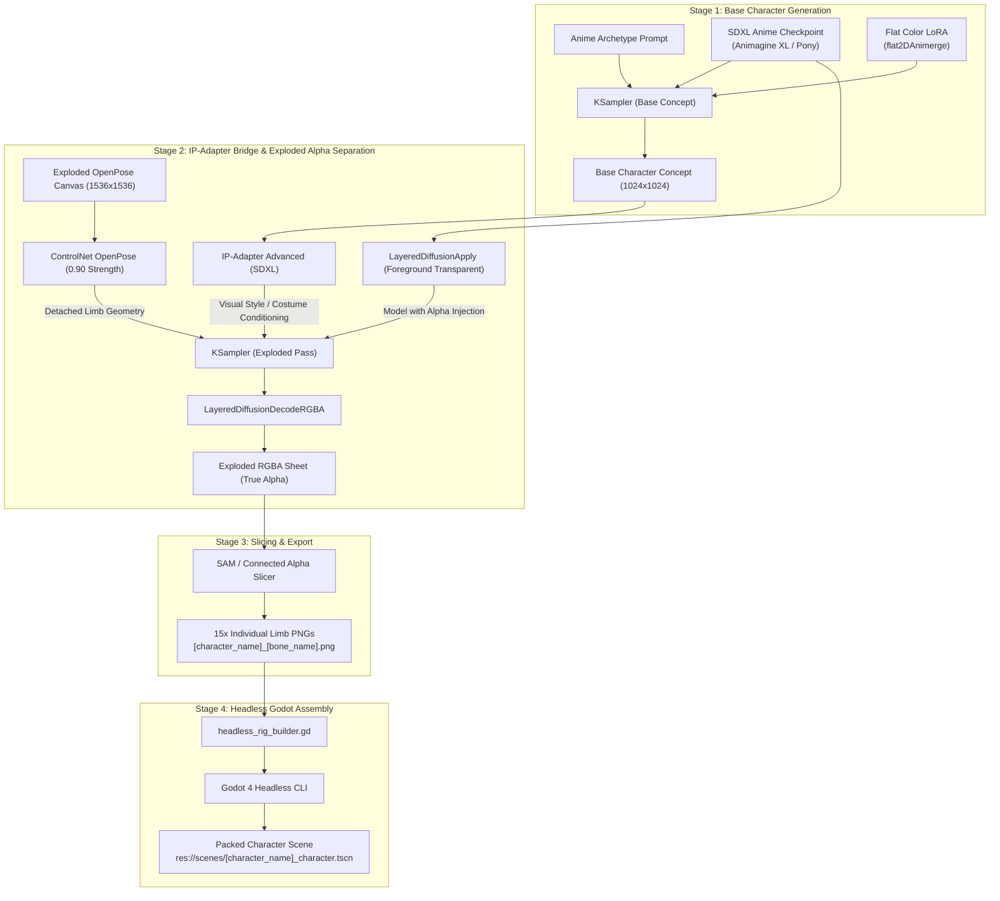

# Godot2dAutoSpriter

An automated 2D asset generation and cut-out sprite rigging pipeline for Godot 4, designed for high-volume character rosters in 2D/2.5D MOBAs, brawlers, and fighting games.

This system connects **ComfyUI generative AI workflows** (using ControlNet OpenPose, LayerDiffuse, and SAM) with **Godot 4's 2D skeletal animation system (`Skeleton2D` / `Bone2D`)**, fully orchestrated by a **Python Model Context Protocol (MCP) server** for AI coding assistants.

---

## 🌟 Key Components

1. **ComfyUI Front-End & Chained Separation**:
   * **Base Generation**: Text-to-Image stage creating 2D anime-style sprites (clean cel-shading, crisp outlines, flat colors).
   * **Bridge to Exploded Separation**: Chains base generation via **IP-Adapter** + **OpenPose ControlNet** + **LayerDiffuse** to render the exact character with limbs detached across an orthographic canvas with true alpha transparency.
   * **VRAM Management**: Sequential queueing and model offloading to run locally on consumer GPUs (8GB–12GB VRAM).
2. **Model Context Protocol (MCP) Server (`server.py`)**:
   * Exposes end-to-end pipeline tools (`generate_character_sprites`, `slice_character_limbs`, `assemble_godot_rig`) to AI agents (Claude Desktop, Cline, Cursor, OpenCode).
3. **Standalone Character CLI (`scripts/create_character.py`)**:
   * 1-command generation and rig assembly for any character archetype without requiring an AI agent or GUI.
4. **Headless Godot 4 Rig Builder (`scripts/headless_rig_builder.gd`)**:
   * Executes via Godot CLI without GUI to bind sliced transparent PNGs to the master `Skeleton2D` template and pack ready-to-use `.tscn` character scenes.
5. **Godot 4 `@tool` Auto-Rigging Importer (`auto_rig_importer.gd`)**:
   * Runs inside the Godot Editor Inspector for manual/interactive auto-rigging with 1-click trigger buttons.
6. **Master Rig Template (`scenes/character_rig_template.tscn`)**:
   * Complete 15-bone MOBA/brawler hierarchy with zero-warning leaf-bone setup.

---

## ⚡ How to Run With an MCP (AI Agent Orchestration)

When using an AI coding assistant (Claude Desktop, Cline, Cursor, Windsurf):

### 1. Register the MCP Server
Add the following to your MCP client config file (e.g. `%APPDATA%\Claude\claude_desktop_config.json`):

```json
{
  "mcpServers": {
    "godot2d-auto-spriter": {
      "command": "python",
      "args": [
        "D:/Projects/Godot2dAutoSpriter/server.py"
      ],
      "env": {
        "COMFYUI_HOST": "127.0.0.1:8188",
        "GODOT_BIN": "Godot_v4.7.2-stable_win64_console.exe"
      }
    }
  }
}
```

### 2. Natural Language Prompting
Simply instruct the AI agent in chat:

> *"Create a new character named 'sorceress' with an 'ice mage with crystal staff and glowing purple robes' theme. Generate the sprites, slice the limbs, and assemble the Godot character scene."*

The AI assistant automatically orchestrates the 3 MCP tools:
1. `generate_character_sprites(character_name="sorceress", archetype_prompt="ice mage with crystal staff...")`
2. `slice_character_limbs(character_name="sorceress", input_image_path="sprites/sorceress/sorceress_exploded.png")`
3. `assemble_godot_rig(character_name="sorceress", assets_dir="res://sprites/sorceress", target_scene_path="res://scenes/sorceress_character.tscn")`

Result: `res://scenes/sorceress_character.tscn` is created and rigged on your disk.

---

## 💻 How to Run Without an MCP (CLI & Scripts)

You can run the full pipeline directly from your terminal or command prompt without any AI agent.

### Option A: The 1-Command CLI (`create_character.py`)
Run the unified character builder to generate the 15 limb sprites and assemble the Godot rig in one step:

```bash
# Create a Mage / Sorceress
python scripts/create_character.py --name sorceress --archetype mage

# Create an Assassin / Ninja
python scripts/create_character.py --name shinobi --archetype assassin

# Create a Heavy Mech / Tank
python scripts/create_character.py --name goliath --archetype mech

# Create an Archer / Ranger
python scripts/create_character.py --name sylvana --archetype ranger

# Create a Knight / Warrior
python scripts/create_character.py --name paladin --archetype warrior

# Create a Beast / Quadruped (Dire Wolf / Mount)
python scripts/create_character.py --name fenrir --archetype beast --rig-type quadruped
```

CLI Options:
* `--name` (`-n`): Character identifier.
* `--archetype` (`-a`): `warrior`, `mage`, `assassin`, `ranger`, `mech`, `beast`.
* `--rig-type` (`-r`): `biped` (15-bone humanoid) or `quadruped` (20-bone beast/mount).
* `--template` (`-t`): Optional custom `.tscn` template path.
* `--prompt` (`-p`): Custom prompt description for ComfyUI.
* `--comfy`: Attempts generating via live local ComfyUI API first.
* `--no-godot`: Only generates the transparent PNGs; skips scene packing.
* `--target-scene` (`-o`): Custom `.tscn` destination path.

### Option B: Headless Godot Assembly via CLI
If you already have your transparent PNGs exported:

```bash
# Biped (Humanoid)
Godot_v4.7.2-stable_win64_console.exe --headless --script scripts/headless_rig_builder.gd -- \
  --character-name sorceress \
  --assets-dir res://sprites/sorceress \
  --target-scene res://scenes/sorceress_character.tscn \
  --rig-type biped

# Quadruped (Beast / Mount)
Godot_v4.7.2-stable_win64_console.exe --headless --script scripts/headless_rig_builder.gd -- \
  --character-name fenrir \
  --assets-dir res://sprites/fenrir \
  --target-scene res://scenes/fenrir_character.tscn \
  --rig-type quadruped
```

### Option C: Godot 4 Editor Plugin GUI (Integrated Dock)

The repository includes a dedicated Godot 4 Editor Plugin in `addons/godot_2d_auto_spriter/`.

1. Open the project in Godot 4 (the plugin is enabled in `project.godot`).
2. Look at the right-hand editor dock panel for **"2D Auto Spriter & Rigger"**.
3. Use the GUI controls:
   * **Character Identifier**: e.g., `warrior`, `fenrir`, `valkyrie`.
   * **Rig Template Architecture**:
     * `Humanoid Biped (15 bones)`
     * `Beast / Quadruped (20 bones)`
     * `Custom Template...`
   * **Sprite PNG Directory**: Browse or type your sprite folder (`res://sprites/<name>`).
   * **Pipeline Actions**:
     * **"Instantiate New Rig Scene"**: Generates a new editable rig scene and opens it.
     * **"Auto-Rig Active Skeleton2D"**: Maps and binds all sprites directly onto the open scene's skeleton with 1 click.
     * **"One-Click Build & Save Scene"**: Assembles, binds, packs, saves, and opens `res://scenes/<name>_character.tscn` immediately.
   * **Multi-Limb & Extra Bones Helper**:
     * **`+ Add Wing Pair (L / R)`**: Adds left/right 2-segment wings (`wing_upper_L/R`, `wing_lower_L/R`) to `torso`.
     * **`+ Add Extra Arms (4/6 Limbs)`**: Adds secondary limb chains (`arm_upper_L2/R2`, `arm_lower_L2/R2`, `hand_L2/R2`) to `torso`.
     * **`+ Add Tail Segment`**: Appends the next numbered tail bone (`tail_01`, `tail_02`, ...) to `pelvis` or the existing tail chain.

---

## 🐾 Quadrupeds, Beasts, & Multi-Limbed Creatures

### 1. Quadruped 20-Bone Architecture
Quadrupeds and beasts use the `scenes/quadruped_rig_template.tscn` hierarchy:

```text
Skeleton2D (AutoRigImporter)
└── pelvis
    ├── tail_01 ── tail_02 ── tail_03
    ├── leg_back_upper_L ── leg_back_lower_L ── paw_back_L
    ├── leg_back_upper_R ── leg_back_lower_R ── paw_back_R
    └── spine
        └── torso
            ├── leg_front_upper_L ── leg_front_lower_L ── paw_front_L
            ├── leg_front_upper_R ── leg_front_lower_R ── paw_front_R
            └── neck
                └── head
```

### 2. Multi-Limb Expansions (Wings, Extra Arms, Multi-Tail)
For bosses, chimeras, centaurs, or multi-armed deities:
* **In the Editor Plugin Dock**: Click **"+ Add Wing Pair"** or **"+ Add Extra Arms"** to automatically add child `Bone2D` nodes with pre-configured `Sprite2D` placeholders and zero-warning angle calculations.
* **Naming Schema**: Sprite parts automatically bind to the new bone names:
  * Wings: `[name]_wing_upper_L.png`, `[name]_wing_lower_L.png`, `[name]_wing_upper_R.png`, `[name]_wing_lower_R.png`
  * Secondary Arms: `[name]_arm_upper_L2.png`, `[name]_arm_lower_L2.png`, `[name]_hand_L2.png`, etc.
  * Extended Tails: `[name]_tail_04.png`, `[name]_tail_05.png`, etc.

---

## 🧙 How to Create Anything Other Than a Warrior (30-Character Roster Guide)

To build a 30-character MOBA/brawler roster, you need a diverse spectrum of archetypes (Mages, Rogues, Tanks, Snipers, Beasts, Mounts).

### 1. Archetype Presets in the Pipeline

| Archetype | Colors & Accents | Visual Elements | CLI Flag | Default Rig |
| :--- | :--- | :--- | :--- | :--- |
| **Beast / Quadruped** | Shadow Black & Emerald Beast Core | Snout, predatory eyes, multi-segment tail, 4 clawed paws | `--archetype beast` | `quadruped` |
| **Mage / Caster** | Deep Violet & Gold with Arcane Magenta Glow | Circlets, cloth cowls, arcane runes, power crystals | `--archetype mage` | `biped` |
| **Assassin / Rogue** | Obsidian Midnight & Crimson Blood Glow | Sleek leather, face mask/cowl, light vambraces, knuckle studs | `--archetype assassin` | `biped` |
| **Mech / Juggernaut** | Gunmetal Gray & Caution Amber / Orange Glow | Heavy reinforced plates, furnace reactor, piston joints | `--archetype mech` | `biped` |
| **Ranger / Scout** | Forest Greens, Leather Browns & Emerald Glow | Agile tunics, utility belts, leather bracers, light greaves | `--archetype ranger` | `biped` |
| **Warrior / Paladin** | Cobalt Steel & Regal Amber Gold with Cyan Core | Heavy breastplate, T-visor helmet, gold crest, poleyns | `--archetype warrior` | `biped` |

### 2. Custom Prompts in ComfyUI
To generate completely new visual styles in ComfyUI:
1. Open ComfyUI and load [`workflows/comfyui_exploded_sprite_workflow.json`](file:///D:/Projects/Godot2dAutoSpriter/workflows/comfyui_exploded_sprite_workflow.json).
2. Select **Node #3 (`CLIPTextEncode`)** and replace the prompt text with your desired character:
   * **Ice Sorceress**:
     `masterpiece, anime 2d game sprite, female ice mage with crystalline staff, flowing frost silk robes, circlet crown, cyan glowing runes, modular exploded limbs, flat cel shading, crisp bold outlines`
   * **Shadow Ninja**:
     `masterpiece, anime 2d game sprite, shadow ninja assassin with oni mask, dual crimson kunai, dark stealth cowl, modular exploded limbs, flat cel shading, crisp bold outlines`
   * **Cyber Juggernaut**:
     `masterpiece, anime 2d game sprite, heavy dieselpunk mech brawler, caution hazard stripes, glowing furnace core, hydraulic limb plating, modular exploded limbs, flat cel shading`
   * **Elven Sniper**:
     `masterpiece, anime 2d game sprite, elven archer scout, green travel cloak, leather quiver straps, agile boots, modular exploded limbs, flat cel shading, crisp bold outlines`
3. Click **Queue Prompt**.
4. The output RGBA exploded sheet will be saved to ComfyUI's output folder.
5. Scribe/crop using `slice_character_limbs` or place into `sprites/<name>/` and run the Godot rig builder!

---

## 🏗️ ComfyUI Workflow Architecture



---

## 📁 Standard Bone Suffix Naming Convention

All 15 limb cutouts follow the pattern `[character_name]_[bone_name].png`:

```text
[character_name]_head.png
[character_name]_torso.png
[character_name]_pelvis.png
[character_name]_arm_upper_L.png
[character_name]_arm_lower_L.png
[character_name]_hand_L.png
[character_name]_arm_upper_R.png
[character_name]_arm_lower_R.png
[character_name]_hand_R.png
[character_name]_leg_upper_L.png
[character_name]_leg_lower_L.png
[character_name]_foot_L.png
[character_name]_leg_upper_R.png
[character_name]_leg_lower_R.png
[character_name]_foot_R.png
```

---

## 🧪 Testing

Run the full automated test suite headless:

```bash
Godot_v4.7.2-stable_win64_console.exe --headless --script tests/test_auto_rig.gd
```

Test MCP tools directly via Python:

```bash
python -c "import server; print(server.assemble_godot_rig('sorceress', 'res://sprites/sorceress'))"
```

---

## 📁 Repository Structure

```text
Godot2dAutoSpriter/
├── addons/
│   └── godot_2d_auto_spriter/                 # Godot 4 Editor Plugin
│       ├── plugin.cfg                         # Plugin configuration metadata
│       ├── plugin.gd                          # EditorPlugin initialization script
│       ├── dock.tscn                          # GUI Dock user interface
│       └── dock.gd                            # Dock logic (auto-rigging & multi-limb tools)
├── server.py                                  # FastMCP server (tools: generate, slice, assemble)
├── auto_rig_importer.gd                       # Core @tool Godot 4 script for Skeleton2D
├── project.godot                              # Godot 4 engine project definition
├── .gitignore                                 # Godot 4 & Python ignore configurations
├── README.md                                  # Complete pipeline & user guide
├── scenes/
│   ├── character_rig_template.tscn            # Master 15-bone humanoid Skeleton2D template
│   ├── quadruped_rig_template.tscn            # Master 20-bone quadruped Skeleton2D template
│   ├── warrior_rigged.tscn                    # Pre-rigged Warrior character
│   ├── sorceress_character.tscn               # Pre-rigged Mage character
│   ├── shinobi_character.tscn                 # Pre-rigged Assassin character
│   └── fenrir_character.tscn                  # Pre-rigged Beast / Quadruped character
├── scripts/
│   ├── create_character.py                    # Standalone 1-command character CLI builder
│   ├── headless_rig_builder.gd                # Headless CLI entry point for scene packing
│   ├── generate_sample_sprites.py             # Multi-archetype stylized sprite generator
│   └── save_rigged_warrior.gd                 # Scene packing utility script
├── sprites/
│   ├── warrior/                               # 15 Warrior limb sprites
│   ├── sorceress/                             # 15 Mage limb sprites
│   ├── shinobi/                               # 15 Assassin limb sprites
│   └── fenrir/                                # 20 Beast / Quadruped limb sprites
├── tests/
│   └── test_auto_rig.gd                       # Headless test suite (Biped & Quadruped)
└── workflows/
    └── comfyui_exploded_sprite_workflow.json  # ComfyUI API workflow definition
```

---

## 📄 License
MIT License. Free to use for commercial and non-commercial game development.