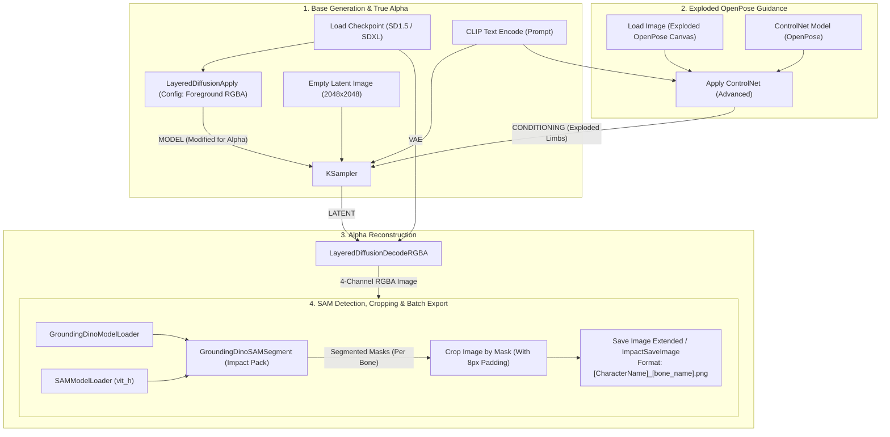

# Godot2dAutoSpriter

An automated 2D asset generation and cut-out sprite rigging pipeline for Godot 4, designed for high-volume character rosters in 2D/2.5D MOBAs, brawlers, and fighting games.

This repository bridges **ComfyUI generative AI workflows** (using ControlNet OpenPose, LayerDiffuse, and SAM) with **Godot 4's 2D skeletal animation system (`Skeleton2D` / `Bone2D`)**.

---

## 🌟 Key Features

* **Exploded Sprite Generation (ComfyUI)**: Architecture for generating modular character sprite sheets where limbs are cleanly detached in space with native alpha transparency (no chroma-key halos).
* **Automated Limb Segmentation (SAM)**: Crops and exports individual body segments into strict, script-readable naming conventions (`[CharacterName]_[bone_name].png`).
* **Godot 4 `@tool` Auto-Rigger (`auto_rig_importer.gd`)**:
  * Runs directly inside the Godot 4 Editor Inspector.
  * Recursively traverses any `Skeleton2D` hierarchy.
  * Matches bone names against PNG filenames via normalized suffix matching.
  * Automatically loads and assigns transparent textures to placeholder `Sprite2D` nodes.
  * Preserves manual bone rest transforms and custom offsets.
* **Master Character Rig Template**: Includes `scenes/character_rig_template.tscn` pre-configured with a 15-part MOBA/brawler bone hierarchy.
* **Automated Test Suite**: Includes a headless Godot test suite (`tests/test_auto_rig.gd`) verifying bone matching, dynamic prefix resolution, and texture loading.

---

## 🏗️ Architecture: ComfyUI "Exploded Sprite" Pipeline



### 1. ControlNet (OpenPose): Forcing Disconnected Limbs
* **Exploded Pose Template**: A 2048×2048 orthographic T-pose map where all joints are translated away from adjacent bones (e.g. head shifted +200px up, arms separated horizontally by 120px, legs separated by 120px).
* **Node**: `Apply ControlNet (Advanced)`.
* **Recommended Settings**:
  * Strength: `0.85` – `0.95`
  * Ending Step: `0.90` (releases guidance during final 10% steps to allow natural joint capping without limb fusion).
* **Prompt Reinforcement**:
  * *Positive*: `2d game cut-out puppet, exploded character sheet, modular separated body parts, anatomical cutouts, flat 2.5d orthographic perspective, neutral lighting, clean borders`.
  * *Negative*: `connected limbs, merged body, overlapping parts, perspective distortion, isometric, volumetric shading artifacts`.

### 2. LayerDiffuse (`LayeredDiffusionApply`): Native Alpha Transparency
* **Extension**: `ComfyUI-layerdiffusion` (by Lvmin Zhang).
* **Node Insertion**: Place `LayeredDiffusionApply` between `Load Checkpoint` and `KSampler`.
* **Config**: `SD15 - Foreground Transparent` or `SDXL - Foreground Transparent`.
* **Decoding**: Replace standard `VAE Decode` with `LayeredDiffusionDecodeRGBA` to generate genuine 4-channel RGBA output without chroma fringe.

### 3. SAM (Segment Anything Model) & Automated Cropping
* **Extension**: `ComfyUI-Impact-Pack` / `ComfyUI-Segment-Anything`.
* **Model**: `sam_vit_h_4b8939.pth` + `GroundingDINO_SwinT_OGC.pth`.
* **Detection & Cropping**: Segment by detection tags (`head . torso . pelvis . upper arm . forearm . hand . thigh . shin . foot`) or coordinate-guided boxes, followed by `Crop Image by Mask` with `8px` padding.

### 4. Output Naming Schema
Output files follow the pattern `[CharacterName]_[bone_name].png`:
```text
warrior_head.png
warrior_torso.png
warrior_pelvis.png
warrior_arm_upper_L.png
warrior_arm_lower_L.png
warrior_hand_L.png
warrior_arm_upper_R.png
warrior_arm_lower_R.png
warrior_hand_R.png
warrior_leg_upper_L.png
warrior_leg_lower_L.png
warrior_foot_L.png
warrior_leg_upper_R.png
warrior_leg_lower_R.png
warrior_foot_R.png
```

---

## 🎮 Godot 4 Auto-Rigging Usage

### Hierarchy Layout
The master rig template (`scenes/character_rig_template.tscn`) uses the following structure:

```text
CharacterRoot (Node2D)
  └─ Skeleton2D (AutoRigImporter.gd attached)
       └─ pelvis (Bone2D)
            ├─ Sprite2D (placeholder texture)
            ├─ torso (Bone2D)
            │    ├─ Sprite2D
            │    ├─ head (Bone2D)
            │    │    └─ Sprite2D
            │    ├─ arm_upper_L (Bone2D)
            │    │    └─ Sprite2D
            │    │         └─ arm_lower_L (Bone2D)
            │    │              └─ Sprite2D
            │    │                   └─ hand_L (Bone2D)
            │    │                        └─ Sprite2D
...
```

### Running in the Godot 4 Editor
1. Open the project in **Godot 4.x**.
2. Open `scenes/character_rig_template.tscn`.
3. Select the `Skeleton2D` node in the Scene tree.
4. In the **Inspector**:
   * Set **`Character Sprites Dir`** to the folder containing your exported PNGs (e.g., `res://sprites/warrior`).
   * *(Optional)* Set **`Character Prefix`** (e.g., `warrior`). If left blank, the script automatically parses everything following the first underscore delimiter (`_`).
   * Toggle **`Reset Sprite Offsets`** if you want to zero out placeholder offsets.
5. Click **`Trigger Auto Rig`**.
6. The editor automatically assigns textures to the matching `Sprite2D` nodes, outputs confirmation logs, and marks the scene as modified for saving (<kbd>Ctrl</kbd> + <kbd>S</kbd>).

---

## 🧪 Running the Test Suite Headless

You can execute the automated test suite from the terminal or CI/CD pipelines without opening the GUI:

```bash
# Windows
Godot_v4.7.2-stable_win64_console.exe --headless --script tests/test_auto_rig.gd

# Linux / macOS
godot --headless --script tests/test_auto_rig.gd
```

**Expected Output:**
```text
==========================================
Starting Godot 4 AutoRigImporter Test Suite
==========================================
Generated 15 fixture PNGs in res://sprites/warrior

--- [AutoRigImporter] Starting Auto-Rigging Sequence ---
[AutoRigImporter] Indexed 15 sprite files from: res://sprites/warrior
[AutoRigImporter] Found 15 Bone2D nodes in skeleton 'Skeleton2D'
  ✓ Assigned [warrior_pelvis.png] -> Bone2D: 'pelvis' (Sprite: 'Sprite2D')
  ✓ Assigned [warrior_torso.png] -> Bone2D: 'torso' (Sprite: 'Sprite2D')
  ✓ Assigned [warrior_head.png] -> Bone2D: 'head' (Sprite: 'Sprite2D')
  ...
--- [AutoRigImporter] Finished Auto-Rigging ---
Successfully rigged 15/15 visual bones.
[ALL TESTS PASSED SUCCESSFULLY!]
```

---

## 📁 Repository Structure

```text
Godot2dAutoSpriter/
├── .gitignore                     # Godot 4 ignore configuration
├── project.godot                  # Godot 4 project definitions
├── auto_rig_importer.gd           # Core @tool AutoRigImporter script
├── scenes/
│   └── character_rig_template.tscn # 15-bone MOBA/brawler Skeleton2D scene
├── sprites/
│   └── warrior/                   # 15 sample transparent limb sprites
├── tests/
│   └── test_auto_rig.gd           # Headless automated test suite
└── README.md                      # Pipeline architecture & documentation
```

---

## 📄 License
MIT License. Free to use and modify for commercial and non-commercial game projects.