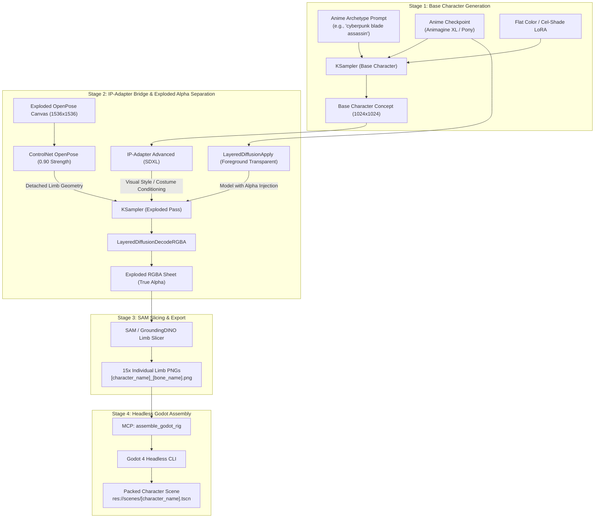

# Godot2dAutoSpriter

An automated 2D asset generation and cut-out sprite rigging pipeline for Godot 4, designed for high-volume character rosters in 2D/2.5D MOBAs, brawlers, and fighting games.

This system connects **ComfyUI generative AI workflows** (using ControlNet OpenPose, LayerDiffuse, and SAM) with **Godot 4's 2D skeletal animation system (`Skeleton2D` / `Bone2D`)**, fully orchestrated by a **Python Model Context Protocol (MCP) server** for AI coding assistants.

---

## 🌟 Key Components

1. **ComfyUI Front-End & Chained Separation**:
   * **Base Generation**: Text-to-Image stage creating 2D anime-style sprites (clean cel-shading, crisp outlines, flat colors).
   * **Bridge to Exploded Separation**: Chains base generation via **IP-Adapter** + **OpenPose ControlNet** + **LayerDiffuse** to render the exact character with limbs detached across an orthographic canvas with true alpha transparency.
   * **VRAM Management**: Sequential queueing and model offloading to run locally on consumer GPUs (8GB–12GB VRAM).
2. **Model Context Protocol (MCP) Server (`server.py`)**:
   * Exposes end-to-end pipeline tools (`generate_character_sprites`, `slice_character_limbs`, `assemble_godot_rig`) to AI agents (Claude Desktop, Cline, Cursor, OpenCode).
3. **Headless Godot 4 Rig Builder (`scripts/headless_rig_builder.gd`)**:
   * Executes via Godot CLI without GUI to bind sliced transparent PNGs to the master `Skeleton2D` template and pack ready-to-use `.tscn` character scenes.
4. **Godot 4 `@tool` Auto-Rigging Importer (`auto_rig_importer.gd`)**:
   * Runs inside the Godot Editor Inspector for manual/interactive auto-rigging with 1-click trigger buttons.
5. **Master Rig Template (`scenes/character_rig_template.tscn`)**:
   * Complete 15-bone MOBA/brawler hierarchy with zero-warning leaf-bone setup.

---

## 🏗️ ComfyUI Front-End & Pipeline Architecture



### 1. Base Generation Node Setup
* **Recommended Checkpoint**: `animagineXL_v31.safetensors` or `ponyDiffusionV6XL.safetensors`.
* **LoRA Pairing**: `flat2DAnimerge_v10.safetensors` (strength `0.7` – `0.85`) to enforce clean anime cel-shading, vibrant flat tones, and bold vector-like outlines.
* **Sampling**: `dpmpp_2m` with `karras` scheduler, 28–32 steps, CFG `7.0`.
* **Resolution**: 1024×1024 for the base concept pass.

### 2. Bridge to Exploded Separation (IP-Adapter + OpenPose + LayerDiffuse)
To retain the character's costume, palette, and design across the exploded limbs:
1. **IP-Adapter**: Feed the base concept image into `IPAdapterAdvanced` (weight `0.75` – `0.85`). This injects the character's visual identity directly into the second diffusion pass.
2. **Exploded OpenPose ControlNet**:
   * Uses an orthographic exploded pose map where limbs are detached by 120px–200px.
   * `Apply ControlNet (Advanced)` with strength `0.90`, ending at step `0.90` (allowing final 10% steps to naturally cap joint ends without limb fusion).
3. **LayerDiffuse (`LayeredDiffusionApply`)**:
   * Placed between Model and KSampler with config `SDXL - Foreground Transparent`.
   * Decoded via `LayeredDiffusionDecodeRGBA` for true 4-channel RGBA output with zero green-screen halo.

### 3. Hardware & VRAM Optimization
* **Sequential Execution**: Run Stage 1 (Base Gen) and Stage 2 (Exploded Pass) sequentially in the queue rather than in parallel latents.
* **Model Unloading**: SAM and GroundingDINO weights (~2.5 GB) are loaded only after diffusion completes, freeing VRAM during the KSampler passes.
* **Flag Recommendation**: Start ComfyUI with `--medvram` or `--lowvram` if running on 8GB GPUs.

---

## 🤖 Model Context Protocol (MCP) Server

The repository includes a production-ready Python MCP server (`server.py`) built on `FastMCP`.

### Exposed MCP Tools

| Tool | Parameters | Description |
| :--- | :--- | :--- |
| **`generate_character_sprites`** | `character_name: str`<br/>`archetype_prompt: str`<br/>`seed: int = -1` | Sends prompt to local ComfyUI API (`/prompt` & WebSocket), monitors generation, and exports exploded RGBA sheet. Includes local fallback generator. |
| **`slice_character_limbs`** | `character_name: str`<br/>`input_image_path: str`<br/>`output_dir: str = ""` | Runs SAM / connected-component alpha segmentation to crop and export 15 transparent limb PNGs matching the strict naming convention. |
| **`assemble_godot_rig`** | `character_name: str`<br/>`assets_dir: str`<br/>`target_scene_path: str = ""` | Calls Godot 4 in headless mode to bind the sliced PNGs to the master `Skeleton2D` template and pack a new character `.tscn`. |

### Client Configuration (`mcpServers`)

To register the server in **Claude Desktop**, **Cline**, **Windsurf**, or **Cursor**, add the following snippet to your MCP configuration file (e.g., `%APPDATA%\Claude\claude_desktop_config.json`):

```json
{
  "mcpServers": {
    "godot2d-auto-spriter": {
      "command": "python",
      "args": [
        "D:/Projects/Godot2dAutoSpriter/server.py"
      ],
      "env": {
        "COMFYUI_HOST": "127.0.0.1:8188",
        "GODOT_BIN": "Godot_v4.7.2-stable_win64_console.exe"
      }
    }
  }
}
```

---

## 🎮 Headless Godot 4 Rig Assembly

You can run the headless scene generator from any terminal or script:

```bash
# Windows
Godot_v4.7.2-stable_win64_console.exe --headless --script scripts/headless_rig_builder.gd -- \
  --character-name warrior \
  --assets-dir res://sprites/warrior \
  --target-scene res://scenes/warrior_character.tscn

# Linux / macOS
godot --headless --script scripts/headless_rig_builder.gd -- \
  --character-name warrior \
  --assets-dir res://sprites/warrior \
  --target-scene res://scenes/warrior_character.tscn
```

### Standard Bone Suffix Naming Convention
```text
[character_name]_head.png
[character_name]_torso.png
[character_name]_pelvis.png
[character_name]_arm_upper_L.png
[character_name]_arm_lower_L.png
[character_name]_hand_L.png
[character_name]_arm_upper_R.png
[character_name]_arm_lower_R.png
[character_name]_hand_R.png
[character_name]_leg_upper_L.png
[character_name]_leg_lower_L.png
[character_name]_foot_L.png
[character_name]_leg_upper_R.png
[character_name]_leg_lower_R.png
[character_name]_foot_R.png
```

---

## 🧪 Testing

Run the full automated test suite headless:

```bash
Godot_v4.7.2-stable_win64_console.exe --headless --script tests/test_auto_rig.gd
```

To test the MCP server tools directly in Python:

```bash
python -c "import server; print(server.assemble_godot_rig('warrior', 'res://sprites/warrior'))"
```

---

## 📁 Repository Structure

```text
Godot2dAutoSpriter/
├── server.py                                  # FastMCP server exposing 3 agentic tools
├── auto_rig_importer.gd                       # Core @tool Godot 4 script for Skeleton2D
├── project.godot                              # Godot 4 engine project definition
├── .gitignore                                 # Godot 4 ignore patterns
├── README.md                                  # Complete architecture & documentation
├── scenes/
│   ├── character_rig_template.tscn            # Master 15-bone Skeleton2D template
│   └── warrior_rigged.tscn                    # Pre-rigged assembled character scene
├── scripts/
│   ├── headless_rig_builder.gd                # Headless CLI entry point for Godot scene assembly
│   ├── generate_sample_sprites.py             # Stylized cut-out sprite generator
│   └── save_rigged_warrior.gd                 # Helper script for packing scenes
├── sprites/
│   └── warrior/                               # 15 distinct, transparent limb sprites
├── tests/
│   └── test_auto_rig.gd                       # Headless test suite (15/15 assertions)
└── workflows/
    └── comfyui_exploded_sprite_workflow.json  # ComfyUI API workflow definition
```

---

## 📄 License
MIT License. Free to use for commercial and non-commercial game development.